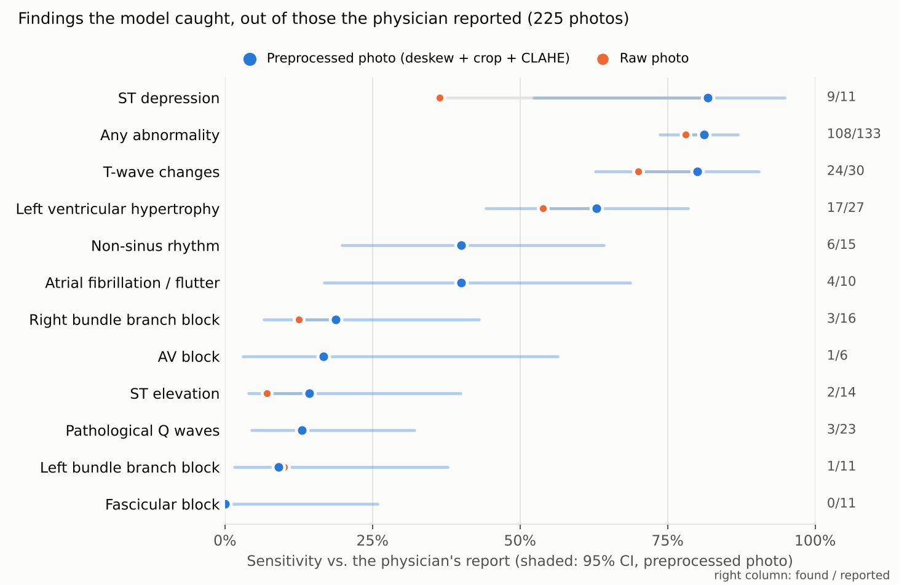
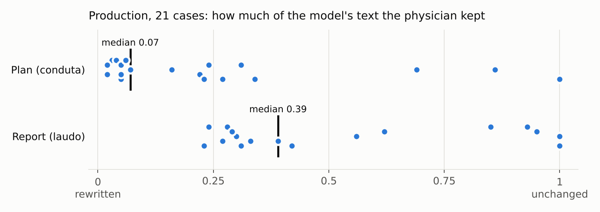

# Paper ECG, phone photo, cardiologist in the loop

**Gabriel Oliveira** · Machine Learning Scientist · M.Sc. in AI @ ITA · [LinkedIn](https://www.linkedin.com/in/gabriel-oliveira-ml) · [GitHub](https://github.com/GabrielSOliveir)

> In many Brazilian emergency rooms, ECGs are printed on thermal paper in different formats. The digital signal
> never reaches the doctor. A general practitioner on call takes a phone photo and sends it to a group of
> specialists. This project puts a model between the photo and the cardiologist. The model **drafts a report and a
> management plan**. The cardiologist **approves or corrects it**, and only the physician-signed version goes back
> to the GP.
>
> The system has run on real cases. **It is not good enough to read ECGs on its own.** This repo documents how I
> built it, how I measured it, and what the measurements say about where it fails.

| | |
|---|---|
| **Workflow** | GP posts photo + clinical context → model drafts report, plan and risk level → cardiologist approves or corrects in a review group → signed answer goes back to the GP (Telegram bot, used on real cases in May 2026) |
| **Data** | 228 phone photos of paper ECGs, each with a report written by a physician. Images and clinical text are private (Brazilian data-protection law, LGPD) and are **not** in this repo |
| **Model** | Multimodal LLM (Claude) with a forced JSON schema for findings → deterministic Python rules for patterns, vital signs and risk → LLM writes the report and plan in the physician's style |
| **Main result** | Flags *some* abnormality in 81% of abnormal ECGs, but over-calls (specificity 32%) and misses most specific diagnoses: **ST elevation 2/14**, LBBB 1/11, RBBB 3/16, AF/flutter 4/10 |
| **What helped** | Image preprocessing (deskew, paper crop, contrast), measured in a paired A/B: better on 14 cases, worse on 4 (sign test p = 0.03) |
| **In production** | The cardiologist corrected 20 of 21 drafts. The management plan was almost always rewritten (median text similarity 0.07) |
| **Stack** | Python, Pydantic, Anthropic API (vision + tool use), OpenCV, SQLite, Telegram Bot API, pytest (50 tests) |

## Decisions I made

The code was written with AI coding agents under my direction. These were my calls:

- **The cardiologist always signs.** The model only drafts. Nothing reaches the GP without a physician's approval or
  correction.
- **Meet the doctors where they already were.** Telegram, the channel in which GPs were already sending ECG photos to
  specialists.
- **Choose the models for each step.** Which Claude model reads the image, which writes the report and which writes the
  plan, and the Sonnet vs. Opus test.
- **Remove retrieval.** Drop the textbook and guideline RAG once a zero-shot model matched or beat it (v1).
- **A schema as the source of truth, rules in Python.** Structured findings in a forced JSON schema; patterns, vital
  signs and risk in deterministic, tested code.
- **Learn the physician's voice from her corrections.** Use approved and corrected cases as few-shot examples for the
  report and the plan.
- **Evaluate per finding.** Compare model and physician field by field on the same schema, instead of by text
  similarity.
- **Attack image quality first, and measure it.** Preprocess the photo (deskew, crop, contrast) and test it in a
  paired A/B before keeping it.

---

## 1. The design: deterministic where possible, LLM only where needed

```
photo + clinical text
  │
  ├─ preprocess (OpenCV)        deskew, crop the paper, CLAHE contrast — each stage can be switched off
  ├─ vision (LLM + tool use)    returns ECGFindings: rhythm, rate, axis, intervals, blocks, ST/T by lead,
  │                             Q waves, hypertrophy, special patterns, image quality
  ├─ quality gate               an unreadable photo returns "inconclusive", never a made-up report
  ├─ pattern classifier (Py)    findings → STEMI by wall, LBBB, AF, ...
  ├─ risk engine (Py)           patterns + vital signs → LOW / INTERMEDIATE / HIGH / EMERGENCY
  │                             (hard rules: SBP < 70, SpO2 < 85, HR < 35 → EMERGENCY)
  ├─ report                     template from the JSON + LLM rewrite in the physician's style (few-shot)
  └─ plan                       LLM, conditioned on report + patient + risk (few-shot from past corrections)
```

The structured `ECGFindings` object ([`system/schemas/findings.py`](system/schemas/findings.py)) is the source of
truth. The report and the chat message are only renderings of it. The same schema is used to parse the physician's
free-text report, so the model and the reference can be compared **field by field** instead of by text similarity.

Everything that does not need an LLM is plain Python with tests: vital signs, pattern classification, risk, and the
comparator ([`system/tests/`](system/tests/), 50 tests).

## 2. How it got here: three versions, each driven by an evaluation

**v1: RAG over textbooks and guidelines.** Two vision passes, retrieval over an ECG textbook and 11 cardiology
guidelines, then a synthesis step. On 46 cases, triage (normal vs. abnormal) reached 81% sensitivity but only 43%
specificity. A **zero-shot model with no retrieval matched the full pipeline on the report and beat it on the plan**
(text similarity 0.43 vs. 0.31). The retrieval was adding cost without adding value, so I removed it
([`docs/v1.md`](docs/v1.md)).

**v2: structured output, rules, and a real workflow.** Rebuilt around the schema above, with risk moved into
tested Python rules. Production and evaluation cases are stored apart (SQLite). The Telegram bot went live with
partial corrections: the cardiologist can fix only the report or only the plan. Every decision is stored so it can
be used as a few-shot example later.

**v3: controlled experiments on the weakest link, the vision step** ([`experiments/`](experiments/)):

- *Preprocessing A/B.* The same 224 photos, the same model and prompt; the only change is preprocessing on or off.
  The reference report is parsed once and cached, so parser errors are identical in both arms and cancel out.
- *Model and prompting pilot.* On 10 cases (the 5 hardest from the A/B plus 5 at random), I compared Claude Sonnet 5 against
  Opus 4.8, with extended thinking and three text examples retrieved by similarity of the clinical complaint.
- *Fine-tuning export.* Physician reports paired with images, in the format a vision fine-tune needs. It is ready,
  but not yet run.

## 3. Results



**How to read the evaluation.** The reference is a short report written in a busy ER. When a physician mentions a
finding, it is almost certainly on the tracing, so **sensitivity is meaningful**. When a finding is not mentioned,
it may still be there. "False positives" are therefore an upper bound on real over-calling, and specificity is a
lower bound. The counts behind every number are in
[`results/aggregate_metrics.json`](results/aggregate_metrics.json), produced by
[`analysis/finding_metrics.py`](analysis/finding_metrics.py).

| Finding | Reported by physician | Found by model | Sensitivity (95% CI) |
|---|---|---|---|
| Any abnormality | 133 | 108 | 81% (74–87) |
| ST depression | 11 | 9 | 82% (52–95) |
| T-wave changes | 30 | 24 | 80% (63–90) |
| Left ventricular hypertrophy | 27 | 17 | 63% (44–78) |
| Atrial fibrillation / flutter | 10 | 4 | 40% (17–69) |
| Right bundle branch block | 16 | 3 | 19% (7–43) |
| **ST elevation** | 14 | **2** | **14% (4–40)** |
| Pathological Q waves | 23 | 3 | 13% (5–32) |
| Left bundle branch block | 11 | 1 | 9% (2–38) |

The pattern is consistent. The model sees that *something* is abnormal, and it picks up diffuse repolarization
changes, often too many of them (T-wave changes are flagged on 70% of the ECGs where the physician did not
mention them). It **fails on the findings that depend on precise morphology across specific leads**: ST elevation,
bundle branch blocks, Q waves. Those are exactly the findings that matter most in an emergency room.

**Preprocessing helps, and the effect is measurable.** In the paired A/B, preprocessing improved the case score on
14 photos and worsened it on 4 (sign test p = 0.031). Recall of reported findings rose from 54.0% to 57.1%
(bootstrap 95% CI of the difference: +1.0 to +5.4 points).

**A bigger model did not fix it.** In the 10-case pilot, recall on the same hard cases was 19% at baseline, 23%
with Sonnet plus thinking and few-shot, and 20% with Opus. Ten cases cannot separate these, but nothing suggested
that model size was the bottleneck.



**In production, the human loop did its job.** From 21 to 27 May 2026 the bot handled 25 real cases, and the
cardiologist decided on 21 of them: 1 approved unchanged, 20 corrected. Reports were mostly shortened: the
median draft was 303 characters, the median signed version 174. Management plans were rewritten almost entirely
(median similarity 0.07). Nothing reached the GP without a physician's signature, which is the point of the design.
But the draft did not save the cardiologist much work.

## 4. Why it fails, and what I would do next

1. **A photo of thermal paper is a hard input.** There are different printers, grid colours, layouts and folds, and
   the photo has perspective, glare and shadows. Preprocessing recovered part of the loss, which shows that image
   quality is one cause.
2. **A general vision LLM is not an ECG reader.** It describes the image well but does not measure millimetres of ST
   deviation lead by lead. More prompting and a larger model did not change that.
3. **The reference is noisy.** The reports are telegraphic, and they are parsed by an LLM into the schema. The paired
   design protects the A/B comparison from this noise, but the absolute numbers carry it.

The next version would split the problem by what each tool does well:

- **Digitize the paper tracing into a signal**, using the kind of methods developed for the 2024 PhysioNet Challenge
  on ECG image digitization.
- **Classify the signal with a model trained on large labelled ECG sets.** Brazil has one of the best: the CODE
  dataset from the Telehealth Network of Minas Gerais, with a public 15% subset. PTB-XL is another option.
- **Keep the LLM for what it did well here:** writing the report and plan in the physician's style from structured
  findings, under the same deterministic risk rules.
- **Keep the cardiologist as the final signature.** Use their corrections as labels, starting with the 20 already
  collected.

## Repo map

```
system/        the running system (v2): schemas, rules, vision, synthesis, pipeline, eval, storage, Telegram bot, tests
experiments/   v3 experiments: preprocessing A/B, model pilot, embedding index for few-shot, fine-tuning export
analysis/      per-finding evaluation used for the figures and tables above
results/       aggregate counts only (no patient-level data)
figures/       make_figures.py and its output
docs/          v1 design and evaluation (retired version)
```

## Run it

```bash
cd system
pip install -r requirements.txt
python -m pytest tests/ -q          # 50 deterministic tests: vital signs, patterns, risk, comparator
cd .. && python figures/make_figures.py
```

The pipeline and the experiments need an Anthropic API key (`system/.env`, see `.env.example`) and the private
dataset. Neither is distributed. `analysis/finding_metrics.py` expects the private result files in
`experiments/results/`.

## Privacy

No ECG images, clinical text, physician reports, database files, Telegram identifiers or credentials are in this
repository or its history. The data stays on the machine where it was collected. **This is a research prototype,
not a medical device, and it is not intended for clinical use without a physician's review.**

*Notes:* code comments and identifiers are in Portuguese (`laudo` = report, `conduta` = management plan,
`achados` = findings, `médica` = physician). The code was written with AI coding agents (Claude Code) under my direction (see "Decisions I made"). Every number
above comes from scripts in this repo run on the private data.
The project was developed over several months in a private repository that also held patient data. It was published
here as a single fresh commit so that no patient data could ever enter the public history. `docs/v1.md` and the
version notes above record the order of the work.
